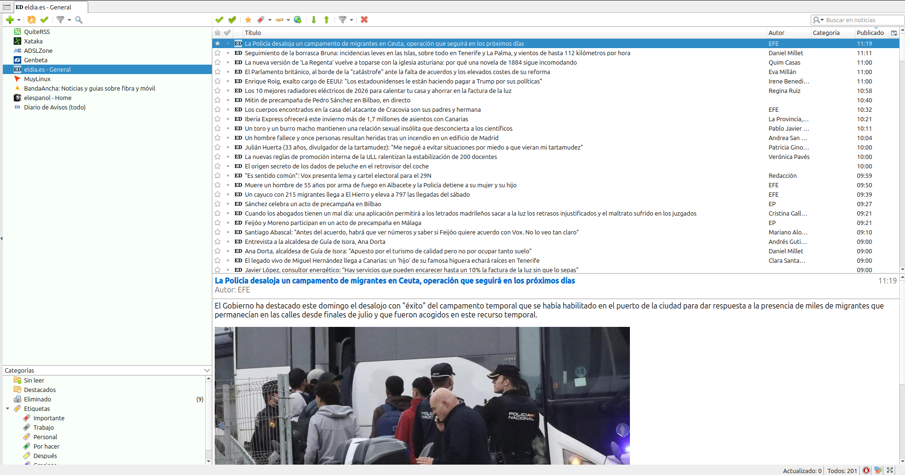

# Noticias

Lector de noticias RSS con la estética de QuiteRSS: barra de pestañas, panel de feeds,
tabla compacta de titulares y previsualización del artículo, todo actualizado
automáticamente cada minuto.

La referencia visual del proyecto es [`docs/quiterss.png`](docs/quiterss.png).



## Funciones

- Ocho feeds RSS importados de la instalación de QuiteRSS del autor.
- El navegador descarga y parsea los RSS; no hay API ni backend de datos.
- Panel lateral con feeds, categorías, no leídas y destacadas.
- Tabla con título, autor, categoría, fuente y fecha de publicación. El logo del feed
  precede al titular y también alterna entre leída y no leída.
- Previsualización del artículo saneada y aislada en un iframe sin scripts.
- Búsqueda sin acentos en título, resumen, autor, feed y categorías.
- Marcado de leídas y destacadas guardado en `localStorage`, con una acción para marcar
  como leídas todas las noticias de la vista actual.
- Opción persistente «Ocultar leídas» para que las noticias ya leídas dejen de aparecer
  en todas las vistas salvo «Destacados».
- Actualización manual y automática cada 60 segundos con cuenta atrás visible.
- El título de la pestaña muestra entre paréntesis el número de noticias no leídas.
- Barras divisorias arrastrables (ancho del panel y altura de la lista).
- Atajos de teclado: `↑`/`↓` para moverse, `Enter` para abrir la noticia original.
- Interfaz móvil propia (≤ 760 px): cabecera compacta, filtros rápidos, tarjetas con
  imagen, cajón de fuentes y artículo a pantalla completa. El escritorio conserva el
  diseño de QuiteRSS.

## Requisitos

- Node.js 26 o superior (véase `.nvmrc`).
- npm 11 o superior.

## Puesta en marcha

```bash
npm install
npm run dev
```

La aplicación queda disponible en <http://127.0.0.1:5173>. Vite incluye un proxy para
`/feed/<id>` que evita las restricciones CORS de las fuentes durante el desarrollo.

El navegador es quien descarga y parsea los RSS con `DOMParser`. Las fuentes que no
envían cabeceras CORS se piden a una ruta same-origin `/feed/<id>` que en local resuelve
Vite o Express y en producción resuelven los rewrites de Vercel.

### Producción

```bash
npm run build
npm start
```

`npm start` levanta Express en el puerto `4173` (configurable con `PORT`), sirve la
carpeta `dist/` y expone el proxy `/feed/<id>`. Express no descarga ni cachea noticias:
solo reenvía el XML para que lo parsee el navegador.

### Vercel

`vercel.json` fija `dist/` como salida y define un rewrite por feed (`/feed/xataka`,
`/feed/genbeta`, etc.) hacia su URL original. Para el navegador todas las fuentes son
same-origin, así que no hay problemas de CORS ni funciones serverless.

Para desplegar, importa el repositorio en Vercel y deja la configuración detectada
(Vite). No hace falta configurar variables de entorno.

GitHub Pages no sirve para esta aplicación tal cual: solo aloja archivos estáticos y no
puede reescribir `/feed/<id>` hacia las fuentes originales.

## Scripts

| Script | Descripción |
| --- | --- |
| `npm run dev` | Servidor de desarrollo con proxy `/feed/<id>`. |
| `npm run build` | Genera la aplicación de producción en `dist/`. |
| `npm start` | Servidor Express de producción con proxy `/feed/<id>`. |
| `npm run lint` | ESLint sobre todo el proyecto. |
| `npm test` | Pruebas con el runner nativo de Node. |
| `npm run check:lines` | Falla si algún archivo de código supera 400 líneas. |
| `npm run check` | Lint + tests + límite de líneas + build. |

## Arquitectura

```text
src/
  App.jsx              estado principal, vistas y atajos
  components/          barra de pestañas, toolbar, sidebar, lista, artículo, estado
  components/mobile/   cabecera, tarjetas, artículo, cajón y espacio de trabajo móvil
  config/feeds.js      lista de fuentes y ruta /feed/<id>
  hooks/               datos de feeds, estado persistente, lectura, destacados y breakpoint
  services/feedLoader.js  descarga concurrente y caché de 55 s en el navegador
  services/parseFeed.js   normalización de RSS/Atom con DOMParser
  services/api.js         fachada que usa el hook de datos
  utils/sanitize.js    limpieza del HTML remoto
  utils/               filtros, fechas y documento HTML del artículo
  styles/              global, layout, sidebar, news, article y bloques mobile-*
server/
  lib/http.js          descarga HTTP con timeout y user-agent
  index.js             servidor Express con proxy /feed/<id>
  vitePlugin.js        proxy /feed/<id> para Vite
vercel.json            rewrites /feed/<id> hacia cada fuente
tests/                 pruebas de utilidades, parseo, saneado y configuración
```

### Carga de feeds

El navegador pide las fuentes a `/feed/<id>`, las parsea con `DOMParser` y guarda una
instantánea en memoria durante 55 segundos. Si una descarga falla, conserva los
últimos artículos de ese feed. El cliente refresca cada 60 segundos y también al
recuperar el foco de la pestaña.

Vite (desarrollo) y Express (producción local) reenvían `/feed/<id>` a la URL real.
En Vercel lo hacen los rewrites de `vercel.json`. No hay caché ni parseo en el servidor.

Cada petición añade `?t=<marca de tiempo>` a `/feed/<id>`. El edge de Vercel usa la URL
completa como clave de caché, así que cada refresco fuerza una descarga nueva en lugar
de reutilizar una copia de hasta dos minutos. La CDN de cada medio sigue aplicando su
propio `Cache-Control`, que es el límite real de frescura.

`eldia.es` es la excepción: su WAF rechaza las peticiones que llegan desde el proxy de
Vercel, pero el feed envía `Access-Control-Allow-Origin: *`. Por eso lleva `direct: true`
en `src/config/feeds.js` y el navegador lo descarga de la URL original sin pasar por
`/feed/<id>`. El resto de fuentes sigue usando el proxy same-origin.

### Feeds

Las fuentes se definen en `src/config/feeds.js`: Xataka, ADSLZone, Genbeta, eldia.es,
MuyLinux, BandaAncha, El Español y Diario de Avisos. Para añadir una fuente hay que
incluir una entrada con `id`, `name`, `url`, `siteUrl`, `icon` y `color`, colocar su
icono en `public/feeds/` y añadir el rewrite correspondiente en `vercel.json`. El test
`tests/feeds.test.js` falla si ambos sitios dejan de estar sincronizados.

### Interfaz móvil

Por debajo de 760 px (`useMediaQuery`) la aplicación cambia a una experiencia propia,
pensada para el pulgar y con menos densidad que la tabla de escritorio:

- Cabecera compacta con acceso al cajón de fuentes, búsqueda plegable, actualización
  manual y filtros rápidos «Todo», «Sin leer» y «Destacadas».
- Tarjetas con imagen, feed, fecha, resumen y etiquetas; un toque abre el artículo y la
  fila inferior permite destacar, marcar como leída o abrir el original.
- Artículo a pantalla completa con navegación anterior/siguiente. El HTML remoto sigue
  en el iframe saneado y con `sandbox`, sin scripts.
- Cajón lateral con todas las fuentes, vistas fijas, categorías y la acción «Marcar
  todas como leídas».
- Barra de estado compacta con la última actualización y la cuenta atrás del refresco.

El layout de escritorio no se modifica: la rama móvil se monta solo cuando la consulta
de medios coincide, y comparte el mismo estado de feeds, lectura y destacados.

### Estado local

| Clave | Contenido |
| --- | --- |
| `noticias:vista` | Vista activa (todo, no leídas, destacadas, feed o categoría). |
| `noticias:leidas` | Identificadores de noticias leídas. |
| `noticias:destacadas` | Identificadores de noticias destacadas. |
| `noticias:ocultar-leidas` | Si está activo, las noticias leídas no se muestran. |
| `noticias:disposicion` | Ancho del panel, altura de la lista y visibilidad del sidebar. |

## Mantenimiento automatizado

- `.github/dependabot.yml` revisa a diario, a las 04:00 de Europa/Madrid, las
  dependencias de npm y de GitHub Actions, y abre las actualizaciones contra `main`.
- `.github/workflows/update-node.yml` se ejecuta a diario a las 03:00 UTC (madrugada
  en España). Consulta la última versión LTS de Node.js y, si hay una versión mayor
  nueva, actualiza `.nvmrc`, `package.json`, `package-lock.json` y el README y sube
  el cambio directamente a `main` como un commit de `github-actions[bot]`. Antes de
  publicarlo instala las dependencias y ejecuta `npm run check` con la nueva versión.
  Dependabot no admite `.nvmrc`, por eso este flujo lo complementa.
- `.github/workflows/ci.yml` ejecuta lint, tests, el límite de 400 líneas y el build
  en cada push y pull request dirigido a `main`, salvo los pushes de
  `github-actions[bot]`: ese token no dispara otros flujos, por eso el actualizador
  de Node valida con `npm run check` antes de publicar.

## Cambios importantes

### 2026-11-10

- Los feeds de X (midudev, DotCSV y LLM Master) apuntaban a `nitter.mizuki.st`, que ahora
  responde con un `301` hacia `ruf.st`. Vercel devolvía ese redirect al navegador, que lo
  seguía fuera de nuestro dominio y terminaba en un error de CORS («Failed to fetch»). Las
  fuentes de `src/config/feeds.js` y los rewrites de `vercel.json` usan ya el dominio final
  `ruf.st`, que responde `200` sin redirecciones.
- Las imágenes y vídeos que llegan por `http` se suben a `https` al sanear el artículo, para
  evitar el aviso de contenido mixto en los tweets con foto.

### 2026-11-09

- Node.js actualizado a la LTS 26 (`.nvmrc`, `engines.node` y README).
- El flujo de actualización de Node.js LTS ya no abre un pull request: valida la nueva
  versión con `npm run check` y hace commit directo en `main` con `github-actions[bot]`.
- El marcado como leída en el escritorio ocurre solo al abrir la noticia: doble clic en el
  titular o «Abrir noticia original» (atajo `Enter`). El clic simple solo selecciona la
  noticia para leerla en la previsualización; ya no la marca como leída automáticamente.
- El doble clic ya no abre el enlace original: solo marca la noticia como leída. El salto al
  artículo se hace con el botón «Abrir noticia original» de la barra de herramientas o con el
  atajo `Enter`, que marcan como leída al abrir.
- La previsualización de eldia.es carga el artículo completo desde su página original
  (párrafos y subtítulos), porque su RSS solo incluye el primer párrafo. La descarga es
  directa desde el navegador (el sitio envía CORS) y, si falla, se mantiene el resumen del
  feed. La extracción se configura por fuente en `src/config/feeds.js` y es extensible a
  otras fuentes.
- El Español también muestra el artículo completo: su página no envía CORS, así que el
  artículo se pide por el proxy same-origin `/elespanol/<ruta>` (Vite, Express y Vercel) y
  se extrae el cuerpo `.article-body__content`, descartando resúmenes con IA, publicidad y
  bloques de noticias relacionadas.
- El Hacker puede servirse con la plantilla de escritorio o con la móvil de Blogger según
  el User-Agent. Con UA móvil, Blogger redirigía a `blog.elhacker.net?m=1`, un salto
  cross-origin que el navegador bloquea por CORS; por eso el proxy añade `?m=1` y recibe
  la plantilla móvil same-origin. La extracción admite varios contenedores
  (`.art-PostContent` y `.post-body`), así que el artículo completo también se ve en
  móviles reales, donde antes solo aparecía el resumen del feed.
- El título de la pestaña pasa a «Noticias — AngelRSS», conservando delante el contador de
  noticias no leídas.
- En escritorio, las flechas ↑/↓ siguen moviendo la selección aunque el foco esté dentro
  de la previsualización del artículo. El iframe mantiene `allow-scripts` desactivado,
  añade `allow-same-origin` solo para escuchar las teclas desde la app y refuerza el
  contenido con una CSP que bloquea scripts, formularios y marcos.

### 2026-11-08

- Versión inicial: importación de los ocho feeds de QuiteRSS, proxy Node con caché de
  55 s, actualización automática cada minuto y saneado del HTML de los artículos.
- Diseño reconstruido a partir de `docs/quiterss.png`: sidebar de 449 px, toolbar de
  30 px, filas de 21 px, selección `#308cc6`, tabla con cabecera fija y
  previsualización inferior con el contenido original del artículo.
- Estado de lectura, destacados y disposición persistidos en `localStorage`.
- Añadido el conmutador «Ocultar leídas» (icono de ojo), persistido en
  `noticias:ocultar-leidas`; se aplica a todas las vistas menos «Destacados» y
  mantiene visible la noticia seleccionada hasta cambiar de selección.
- Añadidos tests, comprobación del límite de 400 líneas por archivo, CI, Dependabot
  diario y flujo automático de actualización de Node.js LTS.
- Carga de feeds trasladada al navegador: `DOMParser` para RSS/Atom, saneado con
  `sanitize-html` en el cliente y caché de 55 s en memoria. Se elimina `/api/news`.
- En local, Vite y Express exponen `/feed/<id>` como proxy; en Vercel lo resuelven
  rewrites same-origin, sin funciones serverless.
- Las peticiones a `/feed/<id>` añaden `?t=<timestamp>` para saltarse la caché del edge
  de Vercel y acercar la actualización al minuto real.
- `eldia.es` se descarga directamente desde el navegador (`direct: true`) porque su WAF
  devuelve 406 a los proxies de Vercel; el feed permite CORS, así que funciona sin
  intermediarios.
- Añadidos tests de parseo RSS/Atom y de sincronización entre `feeds.js` y
  `vercel.json`.
- Nueva interfaz móvil (≤ 760 px) independiente del layout de escritorio: cabecera
  compacta, filtros rápidos, tarjetas con imagen, cajón de fuentes y artículo a pantalla
  completa. Comparte estados de carga/error/vacío con el escritorio mediante
  `NewsFeedback` y mantiene el iframe saneado sin scripts. Los estilos se dividen en
  `mobile.css`, `mobile-article.css`, `mobile-drawer.css` y `mobile-status.css` para
  respetar el límite de 400 líneas.
- El título de la pestaña incluye el total de noticias no leídas, por ejemplo
  `(12) Noticias — AngelRSS`, y se actualiza al marcar leídas o al refrescar los feeds.
- La tabla de escritorio añade la columna «Fuente» y muestra el logo del feed en la
  celda de estado; al pulsarlo se alterna leída/no leída. El estado se representa con
  opacidad y escala de grises, con un punto de respaldo si el feed no tiene icono.
- Nuevo botón «Marcar todas como leídas» en la barra de herramientas y en el cajón
  móvil. Marca únicamente las noticias de la vista filtrada actual y se deshabilita
  cuando no quedan no leídas visibles.
- Añadida la fuente «midudev (X)» a la lista de feeds usando FxTwitter, con el
  avatar de midudev como icono y descarga directa por CORS.
- Añadidas las fuentes «Carlos Santana (DotCSV)» y «LLM Master (X)» (FxTwitter)
  y «El Hacker (Blog)» (Blogger), con sus iconos y rewrites en Vercel.
- El artículo completo de las noticias de El Hacker se carga desde su página
  original y se muestra saneado en el panel de previsualización. Se descarta la
  imagen de cabecera (alojada en dominios externos con anti-hotlink) porque en móvil
  se quedaba cargando y empujaba el texto extendido fuera de la vista; la descarga
  del artículo reintenta una vez antes de volver al resumen del feed.
- Los feeds de X (midudev, DotCSV y LLM Master) se limitan a las 10 últimas
  noticias y se refrescan cada 5 minutos.
- Los titulares no leídos de la tabla de escritorio se muestran en negro, en lugar
  del azul de acento, para alinear su apariencia con la interfaz móvil.
- La fila seleccionada de la tabla de escritorio deja de usar el fondo azul de
  selección y pasa a fondo blanco con letras negras.
